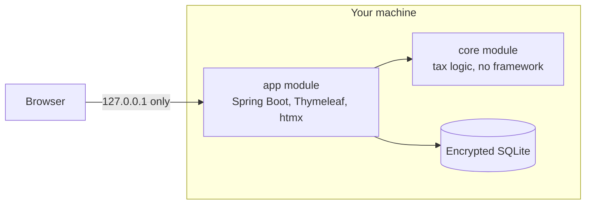
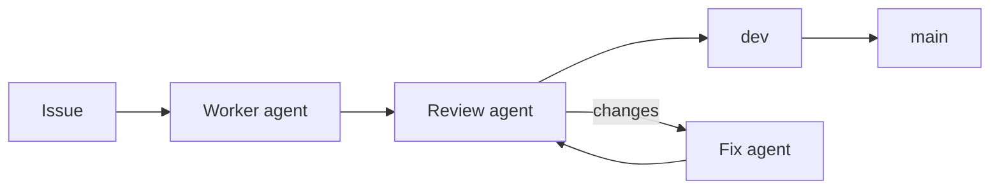

# makeMyTaxes

A local app that prepares a German income tax return. It is my personal project, and also a
showcase for full agentic development, end to end.

**This is not a product.** I build it to prepare my own returns. It is not released for other
people to file with, it covers only part of the tax law, and it gives no tax advice. It is not
an official ELSTER program, and it sends no data to the tax office.

**Status: alpha test.** Versions start at 0.0.1. Features and stored data can change between versions.

## What it does

- Collects expenses with their dates, amounts and receipts
- Checks whether a return is mandatory, with the legal source for each reason
- Holds form modules, and shows each value with its line and evidence for entry in Mein ELSTER
- Holds pinned, per-year versions of the tax laws, so each tax rule can cite the right wording

The UI is in German. It shows the pages of a return as tabs. The fields are in three columns,
grouped by section. Date and amount fields have input masks, date fields have a calendar, and each
field has a clear button. Input that is not saved yet stays when you change tabs. A `?` beside a
field shows a short Italian explanation on hover.

## How it is built



- Java 25, Spring Boot, Thymeleaf, htmx and an encrypted SQLite database
- The tax logic is in a `core` module with no framework
- The app binds to `127.0.0.1`, and it rejects requests from other sites
- Every feature that a user can see has a Playwright test
- A commit hook stops personal data and secrets before they enter the history

## Use the app

You need Java 25. The Maven wrapper downloads Maven.

```
./mvnw -q -B -DskipTests clean package
MAKEMYTAXES_DATABASE_PASSPHRASE=<passphrase> java -jar app/target/app-*.jar
```

Then open <http://127.0.0.1:9091/>. The database is at `~/.local/share/makemytaxes/makemytaxes.db`.
Keep the passphrase. The app cannot open the database without it. The dev container also uses
port 9091, so stop it first with `docker stop makemytaxes-dev`.

### Run a release in Docker

The live container runs a release tag on <http://127.0.0.1:9090/>, with its data in `deploy/data`:

```
cp deploy/.env.example deploy/.env   # then set the passphrase
chmod 600 deploy/.env
scripts/deploy-live.sh v<version>
```

The container does not read the default database path. To keep an existing database, copy it to
`deploy/data/makemytaxes.db` before the first start, and use the same passphrase.

### Run dev in Docker

The dev container runs the latest `origin/dev` on <http://127.0.0.1:9091/>, with made-up test data
only, in `deploy/data-dev`:

```
scripts/deploy-dev.sh
```

On the first start, the script writes a fixed test passphrase to `deploy/.env.dev`. Do not put real
data in the dev container. The review script runs `scripts/deploy-dev.sh` after each merge into `dev`.

## Run the agents

Agents build this project. You write an issue with the label `agent-ready`, and agents work on it up
to a merge into `dev`. Only you merge into `main`.
[The agentic workflow](docs/agentic-workflow.md) explains each step, with pictures.



You need the [`claude`](https://claude.com/claude-code) and [`gh`](https://cli.github.com/) command
line tools, with a login for each, and Docker for the dev container. Prepare the clone once:

```
git config core.hooksPath .githooks   # turn on the commit checks
java scripts/FetchLaws.java           # build the law library
```

The scripts also need the private scan terms in `.privacy/terms.txt`. Git ignores this file. Without
it, the agents do not start.

| Task | Command |
|---|---|
| Run one round | `scripts/agent-loop.sh` |
| Start a round every minute, as a systemd user service | `scripts/install-agent-timer.sh` |
| Read the logs of the service | `journalctl --user -u makemytaxes-agent` |
| Stop the service | `systemctl --user disable --now makemytaxes-agent.timer` |

A round with no work makes no call to Claude. For unattended runs, the service reads
`CLAUDE_CODE_OAUTH_TOKEN` from `~/.config/makemytaxes/agent.env`. Keep this file outside the
repository.

`CLAUDE.md` holds the other commands and the rules of the project.
