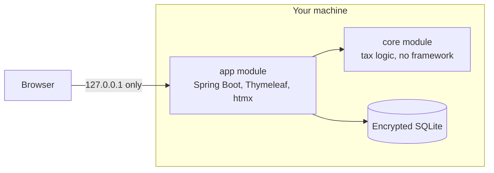
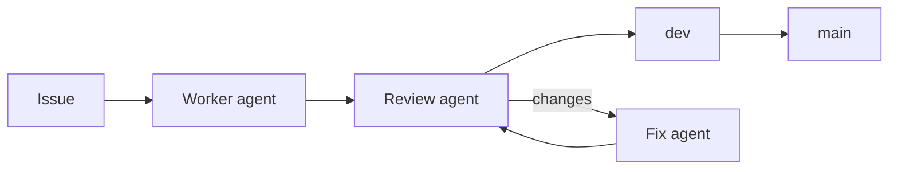

# makeMyTaxes

A local app that prepares a German income tax return. It is my personal project, and also a
showcase for full agentic development, end to end.

**This is not a product.** I build it to prepare my own returns. It is not released for other
people to file with, it covers only part of the tax law, and it gives no tax advice. It is not
an official ELSTER program, and it sends no data to the tax office.

**Status: alpha test.** Versions start at 0.0.1. Features and stored data can change between versions.

## What it does

The UI is in German. A `?` beside each field and question shows a short Italian explanation.

- [Years and people](docs/years.md)
- [Questions](docs/questions.md)
- [Documents](docs/documents.md)
- [Forms and review](docs/forms.md)
- [Assistant](docs/assistant.md)
- [Law library](docs/law-library.md)

## How it is built



- Java 25, Spring Boot, Thymeleaf, htmx and an encrypted SQLite database
- The tax logic is in a `core` module with no framework
- The app binds to `127.0.0.1`, and it rejects requests from other sites
- Every feature that a user can see has a Playwright test
- A commit hook stops personal data and secrets before they enter the history

## Use the app

You need Java 25. The Maven wrapper downloads Maven.

```
./mvnw -q -B -DskipTests clean package
MAKEMYTAXES_DATABASE_PASSPHRASE=<passphrase> java -jar app/target/app-*.jar
```

Then open <http://127.0.0.1:9091/>. The database is at `~/.local/share/makemytaxes/makemytaxes.db`.
Keep the passphrase. The app cannot open the database without it. The dev container also uses
port 9091, so stop it first with `docker stop makemytaxes-dev`.

### Run a release in Docker

The live container runs a release tag on <http://127.0.0.1:9090/>, with its data in `deploy/data`:

```
cp deploy/.env.example deploy/.env   # then set the passphrase
chmod 600 deploy/.env
scripts/deploy-live.sh v<version>
```

The container does not read the default database path. To keep an existing database, copy it to
`deploy/data/makemytaxes.db` before the first start, and use the same passphrase.

### Run dev in Docker

The dev container runs the latest `origin/dev` on <http://127.0.0.1:9091/>, with made-up test data
only, in `deploy/data-dev`:

```
scripts/deploy-dev.sh
```

On the first start, the script writes a fixed test passphrase to `deploy/.env.dev`. Do not put real
data in the dev container. The working loop runs `scripts/deploy-dev.sh` after each merge into `dev`.

## Run the agents

Agents build this project. You write an issue with the label `agent-ready`, and agents work on it up
to a merge into `dev`. Only you merge into `main`.



The working loop is its own project, [minion-army](https://github.com/colla69/minion-army). It runs on
the owner's machine and works on each repository that has a `.minion/config.sh` on `dev`. The folder
`.minion/` holds what the loop needs to know about makeMyTaxes: the paths that only the owner reviews,
the commands of the agents, and the hooks that prepare a worktree, scan before a review and deploy
the dev container. The hooks read the private scan terms from `~/.config/makemytaxes/privacy/`.

`CLAUDE.md` holds the other commands and the rules of the project.
